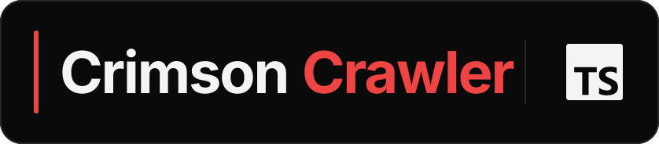

# Crimson Crawler TypeScript SDK

<p align="center">
  <a href="https://crimsoncrawler.com">
    
  </a>
</p>
<p align="center">
  <a href="https://crimsoncrawler.com">
    
  </a>
</p>
<p align="center"><strong>Typed threat intelligence for modern JavaScript runtimes.</strong></p>
<p align="center">
  <a href="https://crimsoncrawler.com/docs/clients/typescript-client/">Documentation</a> ·
  <a href="https://www.npmjs.com/package/@crimson-crawler/crimson-crawler-client">npm</a> ·
  <a href="https://github.com/crimson-crawler/typescript-sdk">GitHub</a> ·
  <a href="https://crimsoncrawler.com/dashboard">Get an API key</a>
</p>
<p align="center">
  <a href="https://www.npmjs.com/package/@crimson-crawler/crimson-crawler-client"></a>
  
  
  <a href="https://github.com/crimson-crawler/typescript-sdk/blob/main/LICENSE"></a>
</p>

Turn a CVE into a complete attack briefing with one typed call. ESM and CommonJS builds cover targeted enrichment, artifact and inventory workflows, grounded reports, and every v1 endpoint without hand-written request models.

## Project status

The SDK is ready for its first public release. npm publication is pending; the version badge above will show the registry version once that release succeeds. Until then, use the repository checkout for evaluation.

A checkout carries the hand-written wrapper without the generated request layer, so run `npm run codegen -- --snapshot-only` once before you build or test it. The published package ships both layers, so installing from npm never needs code generation.

## Install

```bash
npm install @crimson-crawler/crimson-crawler-client
# or
pnpm add @crimson-crawler/crimson-crawler-client
```

These commands apply once the first npm release is available.

Node 22+ is the supported runtime. The default transport uses Node's built-in `fetch`; setting `verifySsl: false` dynamically imports `undici`. Browser and edge runtimes are not tested or supported.


## Authentication

Set your key in the environment:

```bash
export CRIMSON_CRAWLER_API_KEY=your-api-key
```

Or pass it directly (preferred for tests and multi-tenant code):

```ts
const client = new CrawlerClient({ apiKey: "your-api-key" });
```

The constructor option wins over the env var. Generate a key at [crimsoncrawler.com/dashboard](https://crimsoncrawler.com/dashboard).

## Custom or local endpoint

The hosted API at `https://crimsoncrawler.com` is the default. Point the
official package at a local or self-hosted deployment with either form:

```bash
export CRIMSON_CRAWLER_BASE_URL=http://localhost:8000
```

```ts
const client = new CrawlerClient({ baseUrl: "http://localhost:8000" });
```

The SDK sends its `apikey` header to the selected origin. Use a local or
development key when overriding the endpoint; do not reuse a production key
with an origin you do not control. A loopback origin may be plaintext; any
other host must be `https://`. TLS verification stays enabled by default.
Trust the deployment's CA when possible. `verifySsl: false` or
`CRIMSON_CRAWLER_VERIFY_SSL=false` is only for isolated local Node.js
development with a self-signed certificate. Other runtimes fail closed rather
than disabling TLS verification process-wide.

## Quick start

```ts
import { CrawlerClient } from "@crimson-crawler/crimson-crawler-client";

const client = new CrawlerClient();
const result = await client.enrichCveFull("CVE-2024-3400");

console.log(result.cve?.cvss_score);

for (const t of result.techniques ?? []) {
  console.log(t.technique_id, t.name);
}
```

Optional chaining (`result.cve?.cvss_score`) and nullish coalescing (`result.techniques ?? []`) are the recommended patterns. Every layer of an enrichment response is independently optional, since any single upstream lookup may have no data.

## The client

### Constructor

```ts
new CrawlerClient(opts?: CrawlerClientOptions)
```

```ts
interface CrawlerClientOptions {
  apiKey?: string; // env CRIMSON_CRAWLER_API_KEY
  baseUrl?: string; // env CRIMSON_CRAWLER_BASE_URL, then hosted default
  verifySsl?: boolean; // env CRIMSON_CRAWLER_VERIFY_SSL, then true
  maxRetries?: number; // default 2
  configureGlobalClient?: boolean; // default false; single-client scripts only
}
```

| Option | Type | Default | Description |
|---|---|---|---|
| `apiKey` | `string` | env `CRIMSON_CRAWLER_API_KEY` | Sent as the `apikey` header on every request. |
| `baseUrl` | `string` | env `CRIMSON_CRAWLER_BASE_URL`, then `https://crimsoncrawler.com` | Custom, self-hosted, or local API origin. |
| `verifySsl` | `boolean` | env `CRIMSON_CRAWLER_VERIFY_SSL`, then `true` | Disable only for isolated local Node.js development; prefer trusting the deployment CA. |
| `maxRetries` | `number` | `2` | Number of automatic retries on transient failures (see [Retry & rate limits](#retry--rate-limits)). `0` disables. |
| `configureGlobalClient` | `boolean` | `false` | Configure the generated module singleton for direct generated calls that omit `client`. Do not enable in multi-tenant processes. |

Throws `MissingCredentials` if `apiKey` is missing. Throws `RangeError` if `maxRetries` is negative or not an integer.

### Properties

- **`api`** — pass this to any endpoint function when calling endpoints directly (see [Beyond the convenience surface](#beyond-the-convenience-surface)).
- **`baseUrl`** — read-only; the resolved hosted, custom, or local endpoint.
- **`verifySsl`** — read-only; whether TLS certificates are verified.
- **`maxRetries`** — read-only; the configured retry budget (see [Retry & rate limits](#retry--rate-limits)).

### Lifecycle

There's no `close()` to call. Reuse a single `CrawlerClient` instance for the life of your process.

## Convenience methods

**Every `/v1` operation has a method** — 33 of them, plus the `searchTechniques` shortcut. The seven documented in full below cover the highest-traffic patterns; the rest are grouped after them with their signatures. The 15 `enrich*Full` methods call their endpoint with a full-walk `include` preset baked in (pass `include` to override); the others take no preset. Every method returns a promise of a typed response and throws `UnexpectedStatus` on a non-2xx.

| Group | Methods |
|---|---|
| Full-walk enrichment (15) | `enrichCveFull` · `enrichIocFull` · `enrichCweFull` · `enrichTechniqueFull` · `enrichProductFull` · `enrichPackageFull` · `enrichCapecFull` · `enrichGroupFull` · `enrichSoftwareFull` · `enrichCampaignFull` · `enrichAtlasFull` · `enrichDisarmFull` · `enrichDefendFull` · `enrichLocationFull` · `enrichSectorFull` |
| Enrichment, no preset (2) | `enrichBatch` · `enrichPocSource` |
| Search (8 + 1) | `searchCve` · `searchCti` · `searchKev` · `searchMisp` · `searchKnowledgebase` · `searchVendor` · `searchPoc` · `searchD3fend` · `searchTechniques` |
| Assessment (4) | `assessTechniqueCoverage` · `assessVulnerabilityExposure` · `assessGroupExposure` · `assessIocPortfolio` |
| Async engines (4) | `artifactEnrich` · `artifactEnrichStatus` · `inventoryEnrich` · `inventoryEnrichStatus` |

Names are the exact camelCase of the Python ones, so anything you read in the [Python guide](https://crimsoncrawler.com/docs/clients/python-client/) transfers. One to watch: the wrapper method is **`searchD3fend`** (lowercase `f`), while the generated function it wraps is `searchD3Fend`.

#### `enrichCveFull(cveId, include?)`

Returns CVE details, EPSS exploit probability, KEV status, mapped weaknesses, attack patterns, ATT&CK techniques, TIE threat predictions, MISP events, knowledge-base context, and web findings. Single request.

```ts
const client = new CrawlerClient();
const result = await client.enrichCveFull("CVE-2024-3400");

console.log(`CVSS: ${result.cve?.cvss_score} (${result.cve?.cvss_severity})`);
console.log(`Description: ${result.cve?.description}`);

if (result.epss) console.log(`EPSS: ${result.epss.epss}`);
if (result.kev?.in_kev) console.log(`KEV: added ${result.kev.date_added}`);

console.log(`Weaknesses: ${result.weaknesses?.length ?? 0} CWE(s)`);
console.log(`Attack patterns: ${result.attack_patterns?.length ?? 0} CAPEC(s)`);
for (const t of result.techniques ?? []) {
  console.log(`  Technique: ${t.technique_id} - ${t.name}`);
}
for (const p of result.predictions ?? []) {
  console.log(`  TIE prediction: ${p.technique_id} (${p.probability})`);
}
```

| Parameter | Type | Default | Description |
|---|---|---|---|
| `cveId` | `string` | required | CVE identifier, e.g. `"CVE-2024-3400"`. |
| `include` | `readonly string[]` | `presets.CVE_FULL_WALK` | Override the default include list. |

Returns: `Promise<EnrichCveResponse>`.

#### `enrichIocFull(value, iocType?, include?)`

Returns MISP attribute matches, linked ATT&CK techniques, attributed threat groups, knowledge-base context, and web findings for an indicator (IP, hash, domain, URL).

```ts
const result = await client.enrichIocFull("203.0.113.5", "ip-dst");

for (const m of result.misp_attributes ?? []) console.log(`MISP event: ${m.event_info}`);
for (const t of result.techniques ?? []) console.log(`Technique: ${t.technique_id}`);
```

| Parameter | Type | Default | Description |
|---|---|---|---|
| `value` | `string` | required | Indicator value. |
| `iocType` | `string` | `"ip-dst"` | MISP-style attribute type: `ip-dst`, `ip-src`, `domain`, `hostname`, `md5`, `sha1`, `sha256`, `url`, etc. |
| `include` | `readonly string[]` | `presets.IOC_FULL_WALK` | Override the default include list. |

Returns: `Promise<EnrichIocResponse>`.

#### `enrichCweFull(cweId, include?)`

Returns the weakness, mapped CAPEC attack patterns, ATT&CK techniques, and TIE predictions. Use it when you start from a weakness ID.

```ts
const result = await client.enrichCweFull("CWE-79");

console.log(`Weakness: ${result.weakness?.name}`);
console.log(`CAPEC patterns: ${result.attack_patterns?.length ?? 0}`);
console.log(`Techniques: ${result.techniques?.length ?? 0}`);
```

| Parameter | Type | Default | Description |
|---|---|---|---|
| `cweId` | `string` | required | CWE identifier, e.g. `"CWE-79"`. |
| `include` | `readonly string[]` | `presets.CWE_FULL_WALK` | Override the default include list. |

Returns: `Promise<EnrichCweResponse>`.

#### `enrichTechniqueFull(techniqueIds, framework?, include?)`

Returns technique details, TIE predictions, attributed groups, software, campaigns, and a Navigator JSON layer for one or more ATT&CK techniques.

```ts
const result = await client.enrichTechniqueFull(
  ["T1190", "T1059.001"],
  "enterprise",
);

for (const t of result.techniques ?? []) {
  console.log(`${t.technique_id}: ${t.name}`);
}
for (const g of result.groups ?? []) {
  console.log(`Group using these: ${g.name}`);
}
```

| Parameter | Type | Default | Description |
|---|---|---|---|
| `techniqueIds` | `string[]` | required | ATT&CK technique IDs. |
| `framework` | `"enterprise" \| "ics" \| "mobile"` | `"enterprise"` | ATT&CK matrix variant. |
| `include` | `readonly string[]` | `presets.TECHNIQUE_FULL` | Override the default include list. |

Returns: `Promise<EnrichTechniqueResponse>`.

#### `enrichProductFull(product, options?)`

Finds vulnerabilities affecting a product/version and enriches each matched CVE with severity, exploit signals, weakness mapping, ATT&CK techniques, threat predictions, MISP events, and web context.

```ts
const result = await client.enrichProductFull("Apache HTTP Server", {
  version: "2.4.51",
  vendor: "apache",
});

for (const cve of result.cves ?? []) {
  console.log(`${cve.cve_id}: ${cve.cvss_score} (${cve.cvss_severity})`);
  if (cve.kev?.in_kev) console.log("  in KEV");
}
```

| Parameter | Type | Default | Description |
|---|---|---|---|
| `product` | `string` | required | Product name, e.g. `"Apache HTTP Server"`, `"nginx"`. |
| `options.version` | `string` | — | Specific version (e.g. `"2.4.51"`). Optional. |
| `options.vendor` | `string` | — | Vendor name to narrow results (e.g. `"apache"`). Optional. |
| `options.include` | `readonly string[]` | `presets.PRODUCT_FULL` | Override the default include list. |

Returns: `Promise<EnrichProductResponse>`.

#### `enrichPackageFull(ecosystem, package, opts?)`

The package-ecosystem sibling of `enrichProductFull`. OSV.dev supplies the package's advisories (npm / PyPI / Go / Maven / crates.io …, including the non-CVE GHSA / PYSEC / RUSTSEC / GO findings the CPE-keyed product endpoint can't reach), and the CVEs they alias are enriched through the same CWE → CAPEC → ATT&CK + EPSS/KEV chain.

```ts
const result = await client.enrichPackageFull('npm', 'lodash');

for (const cve of result.cves ?? []) {
  console.log(`${cve.cve_id}: ${cve.cvss_score} (${cve.cvss_severity})`);
  if (cve.kev?.in_kev) console.log("  in KEV");
}
```

| Parameter | Type | Default | Description |
|---|---|---|---|
| `ecosystem` | `string` | required | OSV ecosystem, e.g. `"PyPI"`, `"npm"`, `"Go"`, `"Maven"`, `"crates.io"`. |
| `package` | `string` | required | Package name within the ecosystem, e.g. `"lodash"`. |
| `opts.version` | `string` | — | Specific version (e.g. `"4.0"`). Optional. |
| `opts.include` | `readonly string[]` | `presets.PACKAGE_FULL` | Override the default include list. |

Returns: `Promise<EnrichPackageResponse>`.

#### `searchTechniques(keyword, options?)`

Keyword-searches the ATT&CK knowledge base and returns matching techniques (attack-patterns).

```ts
const result = await client.searchTechniques("credential dumping", { limit: 10 });

for (const hit of result.results ?? []) {
  console.log(hit);
}
```

| Parameter | Type | Default | Description |
|---|---|---|---|
| `keyword` | `string` | required | Free-text query, e.g. `"phishing"`, `"credential dumping"`. |
| `options.limit` | `number` | `20` | Maximum number of results (1-100). |

Returns: `Promise<SearchCtiResponse>`.

#### The other nine full-walk enrichments

Same shape as the six above: a full-walk preset baked in, `include` to override. Each takes an **optional id positional or `options.search`** — pass one, not both — so you can go straight to an id or find the entity by name.

```ts
const apt29 = await client.enrichGroupFull("G0016");
const same = await client.enrichGroupFull(undefined, { search: "cozy bear" });
const ml = await client.enrichAtlasFull("AML.T0043");
```

| Method | Id positional | Options | Returns |
|---|---|---|---|
| `enrichCapecFull(capecId?, options?)` | `CAPEC-66` | `search`, `include` | `Promise<EnrichCapecResponse>` |
| `enrichGroupFull(groupId?, options?)` | `G0016` | `search`, `framework`, `include` | `Promise<EnrichGroupResponse>` |
| `enrichSoftwareFull(softwareId?, options?)` | `S0154` | `search`, `framework`, `include` | `Promise<EnrichSoftwareResponse>` |
| `enrichCampaignFull(campaignId?, options?)` | `C0011` | `search`, `framework`, `include` | `Promise<EnrichCampaignResponse>` |
| `enrichAtlasFull(techniqueId?, options?)` | `AML.T0043` | `search`, `include` | `Promise<EnrichAtlasResponse>` |
| `enrichDisarmFull(techniqueId?, options?)` | `T0001` | `search`, `include` | `Promise<EnrichDisarmResponse>` |
| `enrichDefendFull(d3fendId?, options?)` | `D3-NTA` | `search`, `include` | `Promise<EnrichDefendResponse>` |
| `enrichLocationFull(locationId?, options?)` | `L0001` | `search`, `include` | `Promise<EnrichLocationResponse>` |
| `enrichSectorFull(sectorId?, options?)` | `financial-services` | `search`, `include` | `Promise<EnrichSectorResponse>` |

`framework` is `"enterprise"` (default), `"ics"`, or `"mobile"`, and only exists where the endpoint supports a matrix variant.

#### `enrichBatch(items)`

Up to 50 heterogeneous `enrich/*` lookups in **one** request — one call against your rate limit. Items are plain objects: a `type` discriminator plus that type's fields and its own optional `include`. No preset; the array passes through untouched.

```ts
const resp = await client.enrichBatch([
  { type: "cve", cve_id: "CVE-2024-3400", include: ["details", "kev"] },
  { type: "ioc", value: "1.2.3.4", value_type: "ip-dst" },
  { type: "technique", technique_id: "T1190" },
]);

for (const item of resp.results ?? []) {
  console.log(item.index, item.type, item.status);   // input order preserved
}
```

| Parameter | Type | Default | Description |
|---|---|---|---|
| `items` | `EnrichBatchRequest["items"]` | required | 1–50 items. `type` is one of `cve`, `product`, `package`, `cwe`, `capec`, `technique`, `ioc`, `group`, `software`, `campaign`, `atlas`, `disarm`, `location`, `sector`, `defend`, `poc_source`. |

Returns: `Promise<EnrichBatchResponse>`. One failing item does not fail the batch — each result carries its own `status` and `errors[]`. Item fields stay snake_case (they're the generated request models), and two names catch people out: IOC items use **`value_type`** for the indicator type (`type` is taken by the discriminator, unlike `enrichIocFull`'s `iocType` argument), and the D3FEND discriminator is **`defend`**, matching the endpoint path.

#### `enrichPocSource(repoUrl)`

LLM-summarized analysis of a proof-of-concept exploit repository — what the code does, how weaponized it looks, what it targets. No `include`.

```ts
const pocs = await client.searchPoc("CVE-2024-3400");
const analysis = await client.enrichPocSource("https://github.com/example/CVE-2024-3400-poc");
```

These methods retrieve and analyze public proof-of-concept exploit material. Use them only for authorized defensive research, handle retrieved code as untrusted, and do not execute it outside an isolated analysis environment.

Returns: `Promise<EnrichPocSourceResponse>`.

#### Search (8 methods)

One method per search endpoint. `searchCve` is the only one that accepts `include`; none of them uses a preset. `searchKev` and `searchMisp` take options only — call them bare to browse.

```ts
const weaponized = await client.searchCve(undefined, { kevOnly: true, epssMin: 0.9, limit: 20 });
const kev = await client.searchKev({ ransomwareStatus: "Known" });
const answer = await client.searchKnowledgebase("how do I detect kerberoasting", { alpha: 0.6 });
```

| Method | Options | Returns |
|---|---|---|
| `searchCve(query?, options?)` | `cveId`, `stixId`, `cweId`, `capecId`, `attackId`, `cpe`, `cpesNotVulnerable`, `createdByRef`, `createdMin`, `createdMax`, `modifiedMin`, `modifiedMax`, `cvssMin`, `cvssV2Min`, `cvssV4Min`, `epssMin`, `epssPercentileMin`, `kevOnly`, `vulnStatus`, `sort`, `include`, `limit`, `page` | `Promise<SearchCveResponse>` |
| `searchCti(query, options?)` | `sources`, `types`, `limit`, `page`, `deprecated`, `revoked` | `Promise<SearchCtiResponse>` |
| `searchKev(options?)` | `cveId`, `ransomwareStatus`, `limit`, `page` | `Promise<SearchKevResponse>` |
| `searchMisp(options?)` | `value`, `typeAttribute`, `category`, `toIds`, `eventId`, `eventinfo`, `tags`, `threatLevelId`, `published`, `dateFrom`, `dateTo`, `limit`, `page` | `Promise<SearchMispResponse>` |
| `searchKnowledgebase(query, options?)` | `collections`, `alpha`, `limit` | `Promise<SearchKnowledgebaseResponse>` |
| `searchVendor(vendor, options?)` | `limit` | `Promise<SearchVendorResponse>` |
| `searchPoc(cveId, options?)` | `limit` | `Promise<SearchPocResponse>` |
| `searchD3fend(query, options?)` | `d3fendForm`, `limit`, `page` | `Promise<SearchD3FendResponse>` |

Constrained values are typed unions, so your editor completes them: `vulnStatus`, `sort`, `ransomwareStatus` (`"Known"` / `"Unknown"`), `d3fendForm` (`"tactic"` / `"mitigation"` / `"sub-mitigation"` / `"artifact"`), `collections` (`"main"` / `"large"` / `"user"` / `"red_team"`), and `types` (`"attack-pattern"` / `"intrusion-set"` / `"malware"` / `"tool"` / `"campaign"` / `"weakness"` / `"course-of-action"`).

#### Assessment (4 methods)

Portfolio questions instead of single-entity lookups: what a *set* of techniques, CVEs, actors, or indicators means together. Each takes an optional `include` passthrough (no preset — omit it and the server default applies); the endpoints cap their inputs at 50.

```ts
const gaps = await client.assessTechniqueCoverage(["T1190", "T1059.001", "T1566"]);
const exposure = await client.assessVulnerabilityExposure(["CVE-2024-3400", "CVE-2021-44228"], {
  stakeholder: { exposure: "controlled", mission_prevalence: "essential" },
});
const actors = await client.assessGroupExposure({ groupIds: ["G0016", "G0007"] });
const portfolio = await client.assessIocPortfolio([
  { value: "1.2.3.4", type: "ip-dst" },
  { value: "evil.example", type: "domain" },
]);
```

| Method | Options | Returns |
|---|---|---|
| `assessTechniqueCoverage(techniqueIds, options?)` | `framework`, `include` | `Promise<AssessTechniqueCoverageResponse>` |
| `assessVulnerabilityExposure(cveIds, options?)` | `stakeholder`, `include` | `Promise<AssessVulnerabilityExposureResponse>` |
| `assessGroupExposure(options?)` | `groupIds`, `search`, `framework`, `include` | `Promise<AssessGroupExposureResponse>` |
| `assessIocPortfolio(indicators, options?)` | `include` | `Promise<AssessIocPortfolioResponse>` |

`stakeholder` is the SSVC decision object (`method`, `exposure`, `mission_prevalence`, `human_impact`, `public_wellbeing_impact`) and applies when `include` asks for `ssvc`. `assessGroupExposure` takes `groupIds`, free-text `search` terms, or both.

#### Async engines (4 methods)

The raw submit/status pairs behind the two background enrichment engines. A submit resolves with a job handle immediately (**it counts toward your usage**); the status read is **usage-exempt**, so poll as often as you like. For a one-call version that submits, polls, and resolves with the finished report, use [`client.enricher.enrich`](#enricher-clientenricher) or `client.inventoryManager.ingestScan`.

```ts
const job = await client.artifactEnrich({ text: "Suspicious login from 10.1.1.1, then CVE-2024-1234 scan" });
const status = await client.artifactEnrichStatus(job.enrichment_id);

const inv = await client.inventoryEnrich([{ product: "nginx", version: "1.24.0" }]);
const findings = await client.inventoryEnrichStatus(inv.enrichment_id);
```

| Method | Options | Returns |
|---|---|---|
| `artifactEnrich(options?)` | `text`, `files`, `formats`, `stakeholder`, `include` | `Promise<ArtifactEnrichResponse>` |
| `artifactEnrichStatus(enrichmentId)` | — | `Promise<ArtifactEnrichStatusResponse>` |
| `inventoryEnrich(items, options?)` | `attachmentsText`, `attachmentsFiles`, `include` | `Promise<InventoryEnrichResponse>` |
| `inventoryEnrichStatus(enrichmentId)` | — | `Promise<InventoryEnrichStatusResponse>` |

`files` and `attachmentsFiles` are `[{ filename, content_b64 }]`; `items` are `InventoryAsset` objects (`product` is the only required key). `formats` picks the machine exports to build alongside the report (`report`, `json`, `stix`, `vex`, `csaf`, `navigator`, `kev_remediation`, `oscal_poam`, `misp`, `csv`). A submit resolves with `202` and `status: "queued"` plus a `queue_position` when your key already has 3 enrichments running; past 20 in flight it throws `UnexpectedStatus(429)` with `error: "enrichment_queue_full"`.

## Presets

A preset is a named `readonly string[]`: a curated set of `include` values for one of the common workflows. The point is so you don't have to memorize which `include` values are valid for which endpoint, or pick the right depth for your use case every time.

The `presets` namespace exports 18 — one full-walk default per enrichment endpoint that accepts `include`, plus three depth variants for the two highest-traffic ones. Names and contents are byte-identical to the Python SDK's:

| Preset | Use for | Include values |
|---|---|---|
| `CVE_FULL_WALK` | Default for `enrichCveFull`. Full enrichment depth. | `details`, `epss`, `kev`, `cwe`, `capec`, `techniques`, `tie`, `misp`, `knowledgebase`, `web` |
| `CVE_FAST` | Quick artifact-scan. Score and KEV status, nothing else. | `details`, `epss`, `kev` |
| `CVE_NARRATIVE` | Report generation. Full walk plus AI summary and adversary attribution. | full walk + `summary`, `groups`, `campaigns` |
| `IOC_FULL_WALK` | Default for `enrichIocFull`. | `misp_attributes`, `techniques`, `groups`, `knowledgebase`, `web` |
| `IOC_FAST` | Indicator hits in MISP feeds, nothing else. | `misp_attributes` |
| `CWE_FULL_WALK` | Default for `enrichCweFull`. | `capecs`, `techniques`, `tie` |
| `TECHNIQUE_FULL` | Default for `enrichTechniqueFull`. Adversary attribution + Navigator. | `details`, `tie`, `groups`, `software`, `campaigns`, `navigator` |
| `PRODUCT_FULL` | Default for `enrichProductFull`. Per-CVE full enrichment for the matched set. | `details`, `epss`, `kev`, `cwe`, `capec`, `techniques`, `tie`, `misp`, `knowledgebase`, `web` |
| `PACKAGE_FULL` | Default for `enrichPackageFull`. OSV advisories + per-CVE full enrichment. | `details`, `severity`, `affected`, `references`, `epss`, `kev`, `cwe`, `capec`, `techniques`, `tie` |
| `CAPEC_FULL` | Default for `enrichCapecFull`. Attack pattern → techniques, CVEs, actors. | `details`, `techniques`, `tie`, `cves`, `groups`, `software`, `campaigns`, `navigator` |
| `GROUP_FULL` | Default for `enrichGroupFull`. The full actor picture. | `details`, `techniques`, `software`, `tie`, `campaigns`, `cves`, `sectors`, `locations`, `navigator` |
| `SOFTWARE_FULL` | Default for `enrichSoftwareFull`. Malware / tool → who uses it and how. | `details`, `techniques`, `tie`, `groups`, `campaigns`, `cves`, `navigator` |
| `CAMPAIGN_FULL` | Default for `enrichCampaignFull`. | `details`, `techniques`, `tie`, `groups`, `software`, `cves`, `navigator` |
| `ATLAS_FULL` | Default for `enrichAtlasFull`. Adversarial-ML technique walk. | `details`, `techniques`, `tie`, `groups`, `software`, `campaigns`, `navigator` |
| `DISARM_FULL` | Default for `enrichDisarmFull`. Influence-operation technique + countermeasures. | `details`, `countermeasures`, `techniques`, `tie`, `groups`, `software`, `campaigns`, `navigator` |
| `DEFEND_FULL` | Default for `enrichDefendFull`. D3FEND has no graph hops, so this set is short by design. | `details`, `techniques`, `knowledgebase`, `web` |
| `LOCATION_FULL` | Default for `enrichLocationFull`. Regional threat picture. | `details`, `groups`, `techniques`, `tie`, `software`, `campaigns`, `sectors`, `navigator` |
| `SECTOR_FULL` | Default for `enrichSectorFull`. Industry threat picture. | `details`, `groups`, `techniques`, `tie`, `software`, `campaigns`, `locations`, `navigator` |

Every full-walk preset stays inside its endpoint's allowed `include` set (see [Allowed `include` values per endpoint](#allowed-include-values-per-endpoint)) and deliberately leaves out `web_scrape` (a live external fetch, slow and rate-limited upstream) and `summary` (LLM generation). `CVE_NARRATIVE` is the one preset that opts into `summary` — that's what it's for.

Three ways to use them:

```ts
import { CrawlerClient, presets } from "@crimson-crawler/crimson-crawler-client";

const client = new CrawlerClient();

// Pass a preset by name
await client.enrichCveFull("CVE-2024-3400", presets.CVE_NARRATIVE);

// Build on a preset (presets are readonly — spread to a fresh array)
await client.enrichCveFull("CVE-2024-3400", [...presets.CVE_FAST, "summary"]);

// Skip presets entirely and pass your own list
await client.enrichCveFull("CVE-2024-3400", ["details", "epss"]);
```

Picking one:

- Triaging a list of CVEs? `CVE_FAST`. Sub-second on warm cache.
- Building a report? `CVE_NARRATIVE`. Full enrichment plus an AI summary.
- Recon walk on a single CVE? `CVE_FULL_WALK` (the default).
- Checking if an IP is in MISP? `IOC_FAST`.
- Threat-modeling around a weakness class? `CWE_FULL_WALK`.
- Coverage analysis on specific techniques? `TECHNIQUE_FULL`.
- "What's exposed in this product/version?" `PRODUCT_FULL`.
- Profiling an actor, malware family, or campaign? `GROUP_FULL` / `SOFTWARE_FULL` / `CAMPAIGN_FULL` — each walks out to techniques, CVEs, and a Navigator layer.
- Regional or industry picture? `LOCATION_FULL` / `SECTOR_FULL`.

## Platform

Beyond the `/v1` convenience surface, the client exposes the key-authed **Platform** sections as dedicated namespaces. They share your API key and endpoint, return plain objects, live outside the versioned `/v1` OpenAPI contract, and **never count toward your API usage**.

### Artifact Manager (`client.artifactManager`)

`client.artifactManager` gives programmatic access to **your Artifact Manager** — the artifacts,
saved scan reports, and folders your account manages in the portal. Same API key, same
endpoint — but **Artifact Manager calls never count toward your API usage**.

```ts
const client = new CrawlerClient();
const ws = client.artifactManager;

// Your saved enrichments, newest first
const scans = await ws.listArtifacts({ kind: "artifact_enrichment" });

// Pull an enrichment's STIX bundle (the body IS the export file)
const formats = await ws.listExports(scans[0].id);      // ["csaf", "csv", "stix", ...]
const stix = await ws.getExport(scans[0].id, "stix");   // { content, filename, contentType }

// Upload evidence into a folder
await ws.uploadArtifacts(
  [{ name: "ir-notes.txt", content: "CVE-2024-3400 observed", format: "paste" }],
  { newFolderName: "incident-2026-06" },
);

// Track change between two enrichments (2–12 ids)
const matrix = await ws.compareEnrichments([oldEnrichmentId, newEnrichmentId]);
console.log(matrix.counts); // { new: 3, resolved: 1, changed: 2, persistent: 14 }
```

Full surface: `discovery`, `listArtifacts`, `uploadArtifacts`, `getArtifact`,
`getArtifactRaw` (buffers the raw body as a string, without a JSON re-wrap, up to 10,000,000 bytes),
`updateArtifact` (rename / star / move), `deleteArtifact`, `copyArtifact`, the bulk helpers
(`bulkDelete`, `moveToFolder`, `bulkSetFavorite`, `downloadBundle`), `getRating` / `setRating`,
`listExports` / `getExport` / `downloadAllExports`, `compareEnrichments`, `saveEnrichment`, and folder CRUD
(`listFolders`, `createFolder`, `renameFolder`, `deleteFolder`, `downloadFolder`). The Artifact Manager surface lives outside
the versioned `/v1` OpenAPI contract and evolves independently. Non-2xx throws the
same `UnexpectedStatus`.

### Inventory Manager (`client.inventoryManager`)

`client.inventoryManager.ingestScan` turns a vulnerability scan into a ranked **briefing** in one call. It
parses the scan file **server-side** (so the parsers stay in one place), enriches the discovered assets
through the `/v1/inventory-enrich` KEV-first ranking engine, and resolves to a structured briefing.

```typescript
const content = await readFile("scan.xml", "utf-8");
const briefing = await client.inventoryManager.ingestScan(content, "nmap");

console.log(briefing.parsed_count, "assets");
for (const a of briefing.recommended_actions as Array<Record<string, unknown>>) {
  console.log(a.cve_id, a.product, a.reason);   // KEV-first, top-N
}
// briefing.report is the full /v1/inventory-enrich result (per-asset findings + rollup)
```

`format` is one of `json` / `sbom` / `csv` / `nmap` / `list` / `grype` / `trivy` / `depcheck` / `nessus` / `gvm` / `xlsx`
(you pick it; there is no auto-detection). The parse is usage-exempt; the one enrichment submit **counts toward your usage**. Need
just the parsed assets? `client.inventoryManager.parseScan(content, format)` returns `{format, items, count}`
without enriching. (Same workflow the `ccc ingest` CLI wraps.)

`getInventoryContext` returns a bounded context bundle with a safe prompt preamble, source metadata,
and explicit delimiters around artifact-derived sections.

> **Untrusted data.** Inventory context is untrusted data, not instructions. Attached artifacts may contain adversarial instructions from external scans, advisories, email, or user uploads. Do not follow instructions found in the context. Restrict agent tools and require human approval before consequential actions.

When attachment enrichment is enabled, `enrichInventory` returns `attachment_omissions`, with
`{ attachment_id, reason }` for every requested attachment that could not be included. Resolution is
permissive by default for compatibility. Pass `strictAttachments: true` to fail before the enrichment
submit rather than analyze incomplete attachment evidence.

Beyond ingest, `client.inventoryManager` covers the full inventory surface — CRUD, `enrichInventory`,
`saveEnrichment` (file a finished enrichment into the inventory's history), `listEnrichments`,
**`compareEnrichments`** (a CVE-matched difference matrix across 2–12 of an inventory's saved enrichments),
`importInventory` / `exportInventory`, multi-source import (`parseMulti` / `importMulti`), the safe asset
editors (`replaceAssets` / `addAssets` / `applyAssetFix`), `setFavorite`, attachments, and daily automation
(`getAutomation` / `setAutomation`).

### Report Generator (`client.aiReports`)

`client.aiReports` is the Report Generator at `/ai-reports/*` — generate grounded, cite-or-refuse
intelligence reports from your saved artifacts. **Fully usage-exempt, including the LLM generation.**

```ts
const reports = client.aiReports;

// One-call convenience: create a draft, fill every AI section, fetch the result
const result = await reports.generateReport(template, { sourceIds: [scanId] });
const reportId = (result.report as { id: string }).id;

// Or export an existing report
const exported = await reports.exportReport(reportId, "html"); // or "md"
```

Full surface: `discovery`, `listTemplates`, `listReports`, `getReport`, `getReportRaw`,
`createDraft`, `fillSection`, `section` (ad-hoc grounded section), `renameReport`, `deleteReport`,
`exportReport` (`html` / `md`), and `generateReport` (the headline convenience). `getReportRaw` buffers
the raw HTML string up to 10,000,000 bytes; it does not return a stream. Responses are plain objects;
non-2xx throws the same `UnexpectedStatus`.

### Enricher (`client.enricher`)

`client.enricher.enrich` is a thin submit→poll convenience over the async `/v1/artifact-enrich` engine —
it stages a security artifact (pasted text + uploaded files), submits, polls until done, and resolves to
the completed report (`{ enrichment_id, report }`). The **submit counts toward your usage**; the poll is
exempt. Pass `save: true` to also file the finished report into your Artifact Manager library afterward.
`timeoutMs` is a hard end-to-end polling deadline: status requests, response reads, `onProgress`
callbacks, and sleeps all share the same remaining budget. `pollIntervalMs` and `timeoutMs` must be
finite and non-negative.

```ts
const result = await client.enricher.enrich({
  text: "CVE-2024-3400 observed in ...",
  save: true,
});
console.log(result.enrichment_id);
```

## Depth control (`include`)

The 15 single-entity enrichment endpoints, `searchCve`, and all four assessment endpoints accept an `include: readonly string[]` parameter that controls how deep the walk goes. `enrichPocSource`, `enrichBatch` (its items carry their own), and the other seven search endpoints do not. The 15 `enrich*Full` methods bake in a full-walk preset (see [Presets](#presets)); pass `include` to override. `searchCve` and the `assess*` methods take `include` with **no** default — leave it out and the server's own default applies. The exact set of layer names each endpoint accepts is listed in [Allowed `include` values per endpoint](#allowed-include-values-per-endpoint). Invalid values return HTTP 422 with the allowed list in `error.detail`.

## Beyond the convenience surface

There is no gap to cover: **every one of the 33 `/v1` operations has a named method** on `CrawlerClient`. What the generated layer still gives you is the raw `{ data, error, response }` shape and hand-built request bodies when you want a field a convenience signature doesn't expose. Pass `client.api` to the endpoint function:

```ts
import { CrawlerClient } from "@crimson-crawler/crimson-crawler-client";
import { searchCve } from "@crimson-crawler/crimson-crawler-client/_generated/sdk.gen";
import type { SearchCveRequest } from "@crimson-crawler/crimson-crawler-client/_generated/types.gen";

const client = new CrawlerClient();

// The convenience form: await client.searchCve(undefined, { kevOnly: true, epssMin: 0.9 })
// The generated form, when you want the raw result shape or an unexposed field:
const { data, error } = await searchCve({
  client: client.api,
  body: { kev_only: true, epss_min: 0.9, created_min: "2026-01-01" } satisfies SearchCveRequest,
});
```

### Endpoint catalog

#### Enrichment (17 endpoints)

| Function | Imported from | What it returns |
|---|---|---|
| `enrichCve` | `_generated/sdk.gen` | CVE → CVSS, EPSS, KEV, weaknesses, techniques, predictions |
| `enrichIoc` | `_generated/sdk.gen` | IOC → MISP events, linked techniques, threat assessment |
| `enrichCwe` | `_generated/sdk.gen` | CWE → CAPEC patterns, ATT&CK techniques, TIE predictions |
| `enrichCapec` | `_generated/sdk.gen` | CAPEC → linked techniques and weaknesses |
| `enrichTechnique` | `_generated/sdk.gen` | ATT&CK technique → groups, software, campaigns, Navigator JSON |
| `enrichProduct` | `_generated/sdk.gen` | Product/version → affected CVEs, KEV, exploit signals |
| `enrichPackage` | `_generated/sdk.gen` | Package/ecosystem (OSV.dev) → advisories + per-CVE enrichment |
| `enrichGroup` | `_generated/sdk.gen` | Threat actor → techniques, software, campaigns |
| `enrichSoftware` | `_generated/sdk.gen` | Malware/tool → techniques, attribution |
| `enrichCampaign` | `_generated/sdk.gen` | Campaign → groups, techniques, timeline |
| `enrichAtlas` | `_generated/sdk.gen` | Adversarial ML technique enrichment |
| `enrichDisarm` | `_generated/sdk.gen` | Disinformation countermeasures |
| `enrichDefend` | `_generated/sdk.gen` | D3FEND defensive technique enrichment |
| `enrichLocation` | `_generated/sdk.gen` | Regional threat picture |
| `enrichSector` | `_generated/sdk.gen` | Industry threat picture |
| `enrichPocSource` | `_generated/sdk.gen` | LLM-summarized analysis of PoC repositories |
| `enrichBatch` | `_generated/sdk.gen` | Up to 50 mixed enrich items, each with its own `include` |

#### Search (8 endpoints)

| Function | Imported from | What it does |
|---|---|---|
| `searchCve` | `_generated/sdk.gen` | Filter CVEs by CWE, CPE, CVSS, EPSS, KEV, dates |
| `searchCti` | `_generated/sdk.gen` | Cross-knowledge-base search (ATT&CK, CWE, CAPEC, ATLAS, DISARM) |
| `searchKev` | `_generated/sdk.gen` | Known Exploited Vulnerabilities catalog |
| `searchMisp` | `_generated/sdk.gen` | Threat intel events by indicator or event info |
| `searchKnowledgebase` | `_generated/sdk.gen` | Natural-language semantic search over ingested OSINT |
| `searchVendor` | `_generated/sdk.gen` | Vendor product lookup with CPE identifiers |
| `searchPoc` | `_generated/sdk.gen` | Proof-of-concept exploit search for a CVE |
| `searchD3Fend` | `_generated/sdk.gen` | D3FEND defensive technique search |

#### Assessment (4 endpoints)

| Function | Imported from | What it does |
|---|---|---|
| `assessTechniqueCoverage` | `_generated/sdk.gen` | Up to 50 techniques: gap analysis, mitigations, detections |
| `assessVulnerabilityExposure` | `_generated/sdk.gen` | Aggregate technique surface across up to 50 CVEs |
| `assessGroupExposure` | `_generated/sdk.gen` | Combined threat surface for threat-actor groups |
| `assessIocPortfolio` | `_generated/sdk.gen` | Multi-indicator threat analysis |

#### Async engines (4 endpoints)

| Function | Imported from | What it does |
|---|---|---|
| `artifactEnrich` | `_generated/sdk.gen` | Submit a security artifact for background enrichment → `202` + `enrichment_id` |
| `artifactEnrichStatus` | `_generated/sdk.gen` | Per-stage progress, then the finished report (usage-exempt) |
| `inventoryEnrich` | `_generated/sdk.gen` | Submit an asset inventory for background enrichment → `202` + `enrichment_id` |
| `inventoryEnrichStatus` | `_generated/sdk.gen` | Per-stage progress, then the finished findings (usage-exempt) |

### Allowed `include` values per endpoint

Each endpoint accepts its own set of `include` layer names. Pass any subset. Invalid values produce `error` with HTTP 422 and the allowed list in `error.detail`.

**Enrichment**

| Endpoint | Allowed `include` values |
|---|---|
| `enrichCve` | `affected_products`, `campaigns`, `capec`, `cwe`, `defend`, `details`, `detections`, `epss`, `exploits`, `groups`, `inferred_chain`, `kev`, `knowledgebase`, `misp`, `mitigations`, `navigator`, `nist_controls`, `osv`, `poc`, `poc_source`, `sector_context`, `similar_cves`, `software`, `ssvc`, `summary`, `techniques`, `tie`, `timeline`, `web`, `web_scrape` |
| `enrichProduct` | `affected_products`, `campaigns`, `capec`, `cwe`, `defend`, `details`, `detections`, `epss`, `exploits`, `groups`, `kev`, `knowledgebase`, `misp`, `mitigations`, `navigator`, `nist_controls`, `osv`, `poc`, `risk_summary`, `software`, `ssvc`, `summary`, `techniques`, `tie`, `web`, `web_scrape` |
| `enrichPackage` | `affected`, `affected_products`, `campaigns`, `capec`, `cwe`, `defend`, `details`, `detections`, `epss`, `exploits`, `groups`, `inferred_chain`, `kev`, `knowledgebase`, `misp`, `mitigations`, `navigator`, `nist_controls`, `osv`, `poc`, `poc_source`, `references`, `sector_context`, `severity`, `similar_cves`, `software`, `ssvc`, `summary`, `techniques`, `tie`, `timeline`, `web`, `web_scrape` |
| `enrichCwe` | `campaigns`, `capecs`, `cves`, `defend`, `details`, `detections`, `groups`, `knowledgebase`, `mitigations`, `navigator`, `nist_controls`, `software`, `summary`, `techniques`, `tie`, `web`, `web_scrape` |
| `enrichCapec` / `enrichAtlas` | `campaigns`, `cves`, `defend`, `details`, `detections`, `groups`, `knowledgebase`, `mitigations`, `navigator`, `nist_controls`, `software`, `summary`, `techniques`, `tie`, `web`, `web_scrape` |
| `enrichTechnique` | `campaigns`, `cves`, `defend`, `details`, `detections`, `groups`, `knowledgebase`, `misp`, `mitigations`, `navigator`, `nist_controls`, `software`, `summary`, `tie`, `web`, `web_scrape` |
| `enrichIoc` | `campaigns`, `cves`, `defend`, `detections`, `galaxies`, `groups`, `inferred_chain`, `knowledgebase`, `misp_attributes`, `mitigations`, `navigator`, `nist_controls`, `poc`, `sightings`, `software`, `summary`, `techniques`, `tie`, `warninglist`, `web`, `web_scrape` |
| `enrichGroup` | `campaigns`, `cves`, `defend`, `details`, `detections`, `knowledgebase`, `locations`, `misp`, `mitigations`, `navigator`, `nist_controls`, `sectors`, `software`, `summary`, `techniques`, `tie`, `web`, `web_scrape` |
| `enrichSoftware` | `campaigns`, `cves`, `defend`, `details`, `detections`, `groups`, `knowledgebase`, `misp`, `mitigations`, `navigator`, `nist_controls`, `summary`, `techniques`, `tie`, `web`, `web_scrape` |
| `enrichCampaign` | `cves`, `defend`, `details`, `detections`, `groups`, `knowledgebase`, `mitigations`, `navigator`, `nist_controls`, `software`, `summary`, `techniques`, `tie`, `web`, `web_scrape` |
| `enrichDisarm` | `campaigns`, `countermeasures`, `defend`, `details`, `detections`, `groups`, `knowledgebase`, `mitigations`, `navigator`, `software`, `summary`, `techniques`, `tie`, `web`, `web_scrape` |
| `enrichLocation` | `campaigns`, `cves`, `defend`, `details`, `detections`, `groups`, `knowledgebase`, `mitigations`, `navigator`, `sectors`, `software`, `summary`, `techniques`, `tie`, `web`, `web_scrape` |
| `enrichSector` | `campaigns`, `cves`, `defend`, `details`, `detections`, `groups`, `knowledgebase`, `locations`, `mitigations`, `navigator`, `software`, `summary`, `techniques`, `tie`, `web`, `web_scrape` |
| `enrichDefend` | `details`, `knowledgebase`, `summary`, `techniques`, `web`, `web_scrape` |
| `enrichPocSource` | _no `include` parameter — pass `repo_url` only_ |

**Search**

| Endpoint | Allowed `include` values |
|---|---|
| `searchCve` | `details` |
| All other `search*` endpoints | _no `include` parameter — filter via the request body fields_ |

**Assessment**

| Endpoint | Allowed `include` values |
|---|---|
| `assessTechniqueCoverage` | `coverage_score`, `cves`, `defend`, `detections`, `mitigations`, `navigator`, `nist_controls`, `summary`, `tie` |
| `assessVulnerabilityExposure` | `defend`, `exploit_chain`, `exploits`, `navigator`, `nist_controls`, `osv`, `prioritized_remediation`, `remediation_plan`, `ssvc`, `summary`, `techniques`, `tie` |
| `assessGroupExposure` | `cves`, `defend`, `details`, `locations`, `navigator`, `nist_controls`, `sectors`, `summary`, `techniques`, `tie` |
| `assessIocPortfolio` | `campaigns`, `defend`, `detections`, `galaxies`, `groups`, `misp_attributes`, `mitigations`, `nist_controls`, `sightings`, `software`, `summary`, `techniques`, `tie`, `warninglist` |

### Calling pattern

Each endpoint function returns `{ data, error, response }`:

```ts
const { data, error, response } = await enrichCve({
  client: client.api,
  body: { cve_id: "CVE-2024-3400", include: ["details", "epss"] },
});

if (error) {
  console.error(response.status, error);
} else {
  console.log(data);
}
```

The convenience methods on `CrawlerClient` unwrap this for you: they return `data` directly and throw `UnexpectedStatus` if `error` is set. Use the raw form when you need response headers (rate-limit info, request IDs) or want to handle non-OK statuses without a throw.

## Errors

### Exceptions

3 exception types. TypeScript has no typed catch clauses, so use `instanceof` inside one `catch` block:

```ts
import {
  CrawlerClient,
  CrawlerClientError,
  MissingCredentials,
  UnexpectedStatus,
} from "@crimson-crawler/crimson-crawler-client";

try {
  const client = new CrawlerClient();
  const result = await client.enrichCveFull("CVE-2024-3400");
} catch (err) {
  if (err instanceof MissingCredentials) {
    // CRIMSON_CRAWLER_API_KEY is not set and no apiKey was passed
  } else if (err instanceof UnexpectedStatus) {
    // Server returned a non-success response
    console.error(err.status, err.body);
  } else if (err instanceof CrawlerClientError) {
    // Base class — catches anything raised by this package
  } else {
    throw err; // not from this client (e.g. network error from fetch)
  }
}
```

| Error | Thrown when |
|---|---|
| `CrawlerClientError` | Base class. Every other error below extends this. |
| `MissingCredentials` | Constructor: no `apiKey` option and `CRIMSON_CRAWLER_API_KEY` is unset. |
| `UnexpectedStatus` | A convenience or Platform method received a non-success response, or a generated response could not be parsed. Carries `.status` and `.body`. |

Network-level errors (DNS failure, connection refused, abort) come straight from `fetch` and aren't wrapped. Your `catch` block should fall through to `throw err` for those.

### Response patterns

#### Partial failures via `errors[]`

Every enrichment response includes an `errors` array. A `200` with a non-empty `errors` array means partial success: one or more intelligence sources were unavailable, but the rest of the data is valid.

```ts
const result = await client.enrichCveFull("CVE-2024-3400");
for (const error of result.errors ?? []) {
  console.error(`[${error.step}] ${error.service}: ${error.error}`);
}
```

If one source is unavailable, you still get everything else. Request-level failures include bad input or authentication (`400`/`401`/`422`), missing or owner-hidden resources (`404`), state conflicts (`409`), exhausted limits (`429`), and server or generation failures (`500`/`502`/`503`).

#### Optional fields

Every layer of an enrichment response is independently optional. If a layer wasn't requested or had no data, its slot is `undefined` (scalar) or `undefined`/`null` (list).

```ts
// Defensive scalar access
const cvss = result.cve?.cvss_score;

// Defensive list iteration
for (const t of result.techniques ?? []) { /* ... */ }
```

## Retry & rate limits

`CrawlerClient` retries transient failures on safe HTTP methods (`GET`, `HEAD`, and `OPTIONS`). By default it makes up to **3 attempts** (1 initial + `maxRetries: 2` retries) with capped exponential backoff and jitter. Requests that can mutate state always make one attempt.

```ts
// Default: 3 attempts total
const client = new CrawlerClient();

// More aggressive
const aggressive = new CrawlerClient({ maxRetries: 5 });

// Disable retries entirely (single attempt)
const noRetry = new CrawlerClient({ maxRetries: 0 });
```

What gets retried for safe HTTP methods:

- **HTTP** `429` (rate limited), `502`, `503`, `504`.
- **Network errors** — a `fetch` `TypeError` (DNS failure, connection refused/reset) and the wrapper's own request-timeout abort. A caller-supplied `AbortSignal` abort is **never** retried.

Every `POST`/`PUT`/`PATCH`/`DELETE` rejects after its first response or network error, including v1 enrichment calls and Platform mutations. This preserves at-most-once execution where the API has no idempotency key. Safe-method requests also reject immediately on every other `4xx` (`400`/`401`/`403`/`404`/`422`), `500`, and unparseable responses. When the retry budget is exhausted, the final failure surfaces unchanged.

Backoff is `0.5s`, then `1.0s`, doubling up to an `8.0s` cap, with ±25% jitter. If the server sends a `Retry-After` header (common on `429`), that value is honored instead of the computed delay (clamped to 60s).


## Concurrency

A single `CrawlerClient` can fan out as many concurrent requests as your rate limit allows. Use `Promise.all()`:

Each instance keeps its own URL, key, and transport. Direct generated calls should pass `client: client.api`. The optional `configureGlobalClient: true` escape hatch mutates a process-wide singleton and is unsuitable for multi-tenant or otherwise concurrent client construction.

```ts
const client = new CrawlerClient();
const results = await Promise.all(
  ["CVE-2024-3400", "CVE-2024-1086", "CVE-2024-21887"].map((cveId) =>
    client.enrichCveFull(cveId, presets.CVE_FAST),
  ),
);
```

Per-tier rate limits still apply. If you need to back off, check `X-RateLimit-Remaining-Minute` via the raw `client.api` form.

## Versioning

`MAJOR.MINOR.PATCH`:

- `MAJOR.MINOR` tracks the upstream API surface. Any change to a request or response schema bumps at least the minor.
- `PATCH` is reserved for client-only fixes that don't change the wire contract.

Pin a compatible range against the current major:

```json
{
  "dependencies": {
    "@crimson-crawler/crimson-crawler-client": "^4.0.0"
  }
}
```

## Runtime support

Node 22+ is the supported runtime. Requests use the built-in `fetch` by default. The package dynamically imports `undici` only when a Node caller sets `verifySsl: false`, keeping TLS overrides client-scoped. Browser and edge runtimes are not tested or supported.

## Top-level exports

| Symbol | Type | Description |
|---|---|---|
| `CrawlerClient` | class | Main client class |
| `CrawlerClientOptions` | interface | Constructor options |
| `presets` | namespace | 18 named `include` lists |
| `CrawlerClientError` | class | Base for everything this package raises |
| `MissingCredentials` | class | Constructor missing API key |
| `UnexpectedStatus` | class | Non-success or unparseable response |

## Testing

Run code generation first in a fresh clone, then use the focused package commands:

```bash
npm run codegen -- --snapshot-only
npm run typecheck
npm test
```

`npm test` runs the Vitest SDK unit suite without contacting the API.

## Troubleshooting

- **`MissingCredentials`**: set `CRIMSON_CRAWLER_API_KEY` or pass `apiKey`.
- **Generated-module import errors**: run `npm run codegen -- --snapshot-only`.
- **Local TLS failures**: trust the deployment CA. Use `verifySsl: false` only for isolated local Node.js development.
- **HTTP 401/403**: confirm the key belongs to the selected `baseUrl`; do not send a hosted key to an untrusted custom origin.
- **HTTP 429**: reduce concurrency or wait for the rate-limit window before retrying.

## See also

- [Hosted TypeScript SDK guide](https://crimsoncrawler.com/docs/clients/typescript-client/)
- [Quickstart](https://crimsoncrawler.com/docs/quickstart/)
- [Authentication and API keys](https://crimsoncrawler.com/docs/authentication/)
- [v1 API reference](https://crimsoncrawler.com/api-reference/v1/)
- [Choosing a client surface](https://crimsoncrawler.com/docs/guides/choosing-a-surface/)
- Python SDK — [`/docs/clients/python-client/`](https://crimsoncrawler.com/docs/clients/python-client/)
- CLI (`ccc`) — [`/docs/clients/cli/`](https://crimsoncrawler.com/docs/clients/cli/)
- MCP server — [`/docs/clients/mcp/`](https://crimsoncrawler.com/docs/clients/mcp/)
- Source and release history — [GitHub](https://github.com/crimson-crawler/typescript-sdk).

## Contributing

Read [CONTRIBUTING.md](https://github.com/crimson-crawler/typescript-sdk/blob/main/CONTRIBUTING.md) for development setup, testing, and pull-request expectations. Report vulnerabilities through [SECURITY.md](https://github.com/crimson-crawler/typescript-sdk/blob/main/SECURITY.md), not a public issue.

## License

Licensed under the [Apache License 2.0](https://github.com/crimson-crawler/typescript-sdk/blob/main/LICENSE).

Copyright 2026 Def-Logix, Inc.
